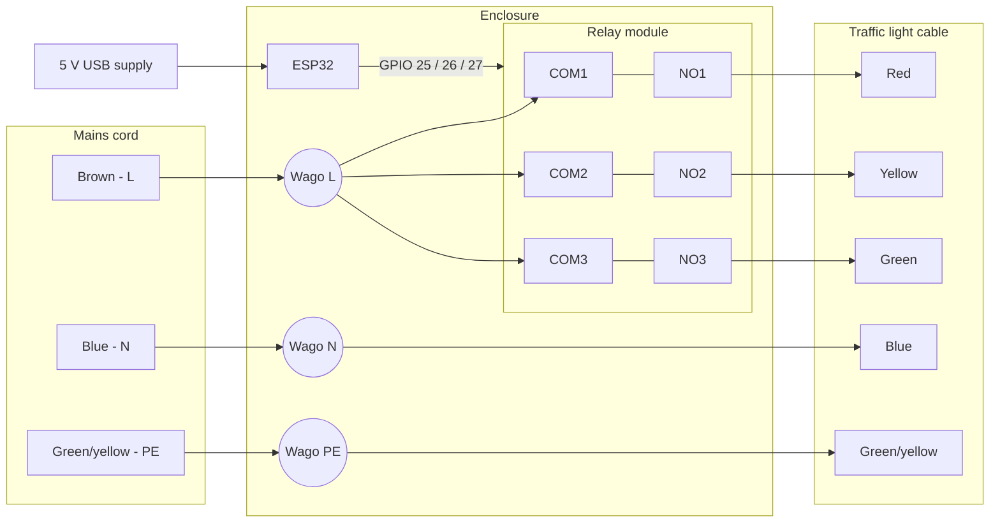

# Hardware

The light is a real Dutch traffic light (NH article 659103/K, tested 19-07-1995), switched at 230 V by an ESP32 through a relay module.

> [!WARNING]
> This build switches mains voltage (230 V AC). Only open the enclosure with the plug pulled, and keep the fixture's metal housing earthed.

## The traffic light

Inside the fixture each lamp has its own transformer: a 230 V primary feeding a 12 V / 20 W halogen lamp. Total load with all three lamps on is about 70 W.

The fixture's cable has six cores:

| Core         | Function                           |
|--------------|------------------------------------|
| Red          | Red lamp (switched line)           |
| Yellow       | Orange lamp (switched line)        |
| Green        | Green lamp (switched line)         |
| Blue         | Shared neutral for all three lamps |
| Green/yellow | Protective earth, bolted to chassis |
| Grey/brown   | Unused spare, cut short and insulated |

## Parts

| Part | Notes |
|------|-------|
| ESP32 dev board | `esp32dev` in PlatformIO |
| 4-channel 5 V relay module, high/low-active selectable | Set to high-active, 3 of 4 channels used |
| 5 V USB power supply | Powers ESP32 and relay coils, ≥1 A recommended |
| Wago 221 connectors | Line, neutral and earth distribution |
| 3-core mains cord with earthed plug | |
| Enclosure with cable glands | Keeps all mains connections covered |

Optional, for a single-cord build: an HLK-5M05 (230 V → 5 V, 1 A) module instead of the USB supply.

## Wiring

### Mains side

- **Line (brown):** plug → Wago → COM1, COM2 and COM3.
- **Lamps:** NO1 → red, NO2 → yellow (orange lamp), NO3 → green. The NC terminals stay empty, so the light goes dark if the ESP32 or its power fails.
- **Neutral (blue):** plug → Wago → the light's blue core. Neutral never goes to the relay module.
- **Earth (green/yellow):** plug → its own Wago → the light's green/yellow core. Nothing else connects to it.

### Low-voltage side

| ESP32 pin | Relay module |
|-----------|--------------|
| GPIO 25   | IN1 (red)    |
| GPIO 26   | IN2 (orange) |
| GPIO 27   | IN3 (green)  |
| 5V / VIN  | DC+          |
| GND       | DC−          |

The ESP32 is powered over USB-C. The relay module's 5 V comes from the ESP32's 5V pin. Coil current is about 70 mA per relay, so with all relays on the ESP32 plus coils draw roughly 0.5 A.
